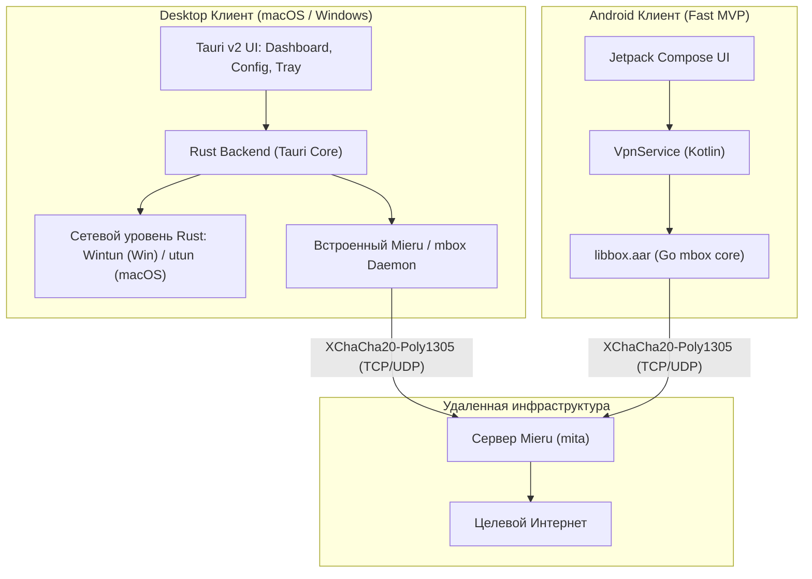
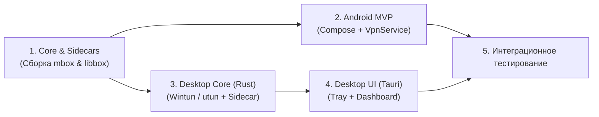

# План разработки VPN-клиента Mieru (Desktop: Rust | Mobile: Android)

## Описание цели

Создание MVP VPN-клиента для протокола **Mieru** с разделением технологического стека по прагматичному критерию максимальной эффективности:
1. **Desktop (macOS, Windows):** Реализация на **Rust + Tauri v2**. Обеспечивает минимальное потребление ресурсов (RAM 20–30 МБ вместо сотен мегабайт Electron), нативный контроль над системными сетевыми драйверами (Wintun / utun), автозапуск и системный трей.
2. **Mobile (Android — Fast-track):** Реализация на **Kotlin + Jetpack Compose** с интеграцией готового ядра **`mbox` (`libbox.aar`)**. Позволяет запустить полноценный Android VPN с интерфейсом за несколько дней без необходимости портировать сложные мобильные сетевые модули.
3. **iOS:** Исключен из рамок MVP для ускорения релиза (будет реализован на следующем этапе с учетом ограничений памяти Network Extension).

---

## Архитектура решения



---

## Ключевые архитектурные решения

1. **Механизм туннелирования на Desktop (Rust):**
   - **Windows:** Крейт `wintun` (создание виртуального адаптера, настройка шлюза `0.0.0.0/0` и DNS).
   - **macOS:** Нативный `utun` сокет + настройка маршрутов через системные вызовы.
   - **Перенаправление трафика:** Высокопроизводительный Rust-модуль `tun2proxy` (или встроенный TUN-модуль ядра `mbox`), который связывает L3-пакеты виртуального адаптера с локальным Mieru-прокси.

2. **Быстрый трек Android (Time-to-Market):**
   - Использование `libbox.aar` (Go mbox) на Android позволяет использовать готовый проверенный сетевой стек `gVisor netstack` и `VpnService` без написания NDK/JNI с нуля. Это сокращает срок разработки Android-версии до 4–6 дней.

---

## Структура проекта

```
meiru-client/
├── PLAN.md                     # Этот документ
├── core/                       # Go mbox / Mieru core
│   ├── build-android.sh        # Сборка libbox.aar для Android
│   └── build-desktop.sh        # Сборка core sidecar для macOS & Windows
├── desktop/                    # Desktop-приложение на Rust (Tauri v2)
│   ├── src-tauri/
│   │   ├── src/
│   │   │   ├── main.rs         # Точка входа Tauri
│   │   │   ├── vpn/            # Управление TUN, маршрутами и Wintun/utun
│   │   │   ├── core_manager.rs # Запуск/мониторинг Mieru sidecar процесса
│   │   │   ├── tray.rs         # Системный трей (сворачивание, статус)
│   │   │   └── config.rs       # Хранение и валидация конфигов
│   │   ├── Cargo.toml
│   │   └── tauri.conf.json
│   └── ui/                     # Легкий веб-интерфейс (Tauri Frontend)
│       ├── index.html
│       ├── src/                # Компоненты: Dashboard, Config, Logs
│       └── package.json
├── android/                    # Android-приложение (Kotlin + Compose)
│   ├── app/
│   │   ├── src/main/
│   │   │   ├── kotlin/.../
│   │   │   │   ├── MainActivity.kt     # Jetpack Compose UI
│   │   │   │   ├── MieruVpnService.kt  # Android VpnService
│   │   │   │   └── ConfigManager.kt    # Управление профилями
│   │   │   └── AndroidManifest.xml
│   │   └── build.gradle.kts
│   └── libs/
│       └── libbox.aar                  # Скомпилированное Go-ядро
└── configs/                            # Примеры и схемы конфигов Mieru
```

---

## Детали компонентов

### 1. Ядро (`core/`)

- Сборка бинарников `mbox` под целевые платформы:
  - `mbox-windows-amd64.exe`
  - `mbox-darwin-arm64` / `mbox-darwin-amd64`
  - `libbox.aar` (Android arm64-v8a, armeabi-v7a, x86_64).
- Автоматическая генерация конфигурации `config.json` с секцией `mieru` outbound:
  ```json
  {
    "log": { "level": "warn" },
    "inbounds": [
      {
        "type": "mixed",
        "tag": "mixed-in",
        "listen": "127.0.0.1",
        "listen_port": 12080
      }
    ],
    "outbounds": [
      {
        "type": "mieru",
        "tag": "mieru-out",
        "server": "{{server}}",
        "server_port": {{server_port}},
        "transport": "{{transport}}",
        "username": "{{username}}",
        "password": "{{password}}",
        "traffic_pattern": "{{traffic_pattern}}"
      }
    ]
  }
  ```

---

### 2. Десктоп на Rust (`desktop/`)

- **Сетевой уровень Rust (`src-tauri/src/vpn/`):**
  - Интеграция `wintun` на Windows для создания сетевого адаптера `MieruTunnel`.
  - Заворачивание трафика в локальный SOCKS5/HTTP порт Mieru через асинхронный `tokio` пайплайн (`tun2proxy`).
  - Восстановление сетевых маршрутов и DNS при корректном и аварийном завершении.
- **Управление процессом ядра (`src-tauri/src/core_manager.rs`):**
  - Старт / Стоп / Рестарт sidecar-процесса Mieru.
  - Health check и мониторинг логов.
  - Передача статуса подключения в UI через события Tauri (`emit("vpn-status")`).
- **Системный трей (`src-tauri/src/tray.rs`):**
  - Иконка статуса (Серый: выключен, Зеленый: подключен, Желтый: подключение).
  - Контекстное меню: «Подключить / Отключить», «Показать окно», «Выход».
- **Пользовательский интерфейс (`ui/`):**
  - Минималистичный UI на Tailwind CSS.
  - Главная кнопка-индикатор (Toggle VPN).
  - Модальное окно добавления профиля (ручной ввод, JSON, ссылка `mieru://`).

---

### 3. Android-клиент (`android/`)

- **`MainActivity.kt` (Jetpack Compose):**
  - Экран в стиле Material 3: кнопка включения, статус, карточка профиля.
  - Запрос разрешения `VpnService.prepare()`.
  - Импорт конфигураций (вставка текста / сканирование QR-кода).
- **`MieruVpnService.kt`:**
  - Служба `VpnService` с Foreground Notification.
  - Инициализация `libbox.BoxService` с передачей JSON-конфигурации.
  - Защита сокетов через `protect()` для предотвращения петель маршрутизации.

---

## План этапов разработки



| Фаза | Задачи | Срок | Результат |
|---|---|---|---|
| **Этап 1: Core** | Сборка `mbox` под Windows/macOS и сборка `libbox.aar` под Android. Подготовка скриптов сборки. | 2 дня | Готовые бинарные библиотеки и исполняемые файлы ядра. |
| **Этап 2: Android MVP** | Создание проекта Android, импорт `libbox.aar`, реализация `VpnService` + Compose экран с 1 кнопкой. | 4 дня | **Готовый рабочий Android APK** (весь трафик идет через Mieru). |
| **Этап 3: Desktop Rust Core** | Инициализация Tauri v2 проекта, реализация Rust-модулей управления TUN (Wintun/utun) и sidecar. | 4 дня | Работающий консольный запуск туннеля через Rust на macOS и Windows. |
| **Этап 4: Desktop UI & Tray** | Верстка UI на Tailwind, интеграция с Rust через Tauri commands, системный трей, сборка `.msi` и `.dmg`. | 3 дня | **Готовые десктопные установщики** под macOS и Windows. |
| **Этап 5: Тестирование** | Проверка утечек DNS, авто-реконнект при обрыве, замеры скорости. | 2 дня | Релизная сборка MVP. |
| **ИТОГО:** | **Полный стек MVP (Android + macOS + Windows)** | **~2.5 недели** | |

---

## План верификации

### Автоматические проверки
- Компиляция Rust-бэкенда: `cargo check` и `cargo clippy`.
- Тест сборки Android: `./gradlew assembleRelease`.
- Тест сборки Tauri: `pnpm tauri build` (на macOS и Windows).

### Сетевое ручное тестирование
1. **Тестирование Android:**
   - Установка APK на устройство/эмулятор, ввод конфига Mieru.
   - Проверка поднятия туннеля (появление ключа в статус-баре).
   - Проверка `https://ipleak.net`: IP меняется на серверный, утечки DNS отсутствуют.
2. **Тестирование Desktop (macOS & Windows):**
   - Запуск приложения, запуск туннеля.
   - Проверка сетевых адаптеров: на Windows — адаптер `Wintun`, на macOS — интерфейс `utun`.
   - Проверка закрытия окна: приложение сворачивается в системный трей, трафик продолжает идти через VPN.
   - Проверка кнопки «Выход» в трее: корректное снятие маршрутов и возврат к прямому интернету.
